# Graph delta demo — Meta Model API

A replay of one real knowledge-graph session over the public **Meta Model API
documentation** (`dev.meta.ai`): **206 deltas in 23 atomic bundles** — 79 nodes
created, 112 edges created, 11 property changes, and a correction that repoints
a reference and supersedes a canonical edge.

Open it by double-clicking **`index.html`**: everything (graph data and player)
is embedded, so it needs no server, no network, and no database. The **chat
drawer** is the one part that needs the local server (`server.py`), because it
queries the live graph.

```
open demo/graph_delta/index.html
```

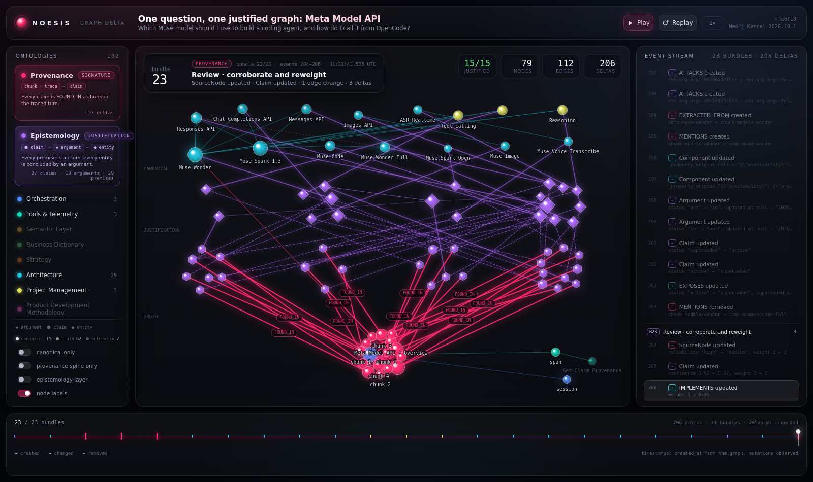

## Is this real data?

The **graph mechanics are real**: every node, edge and `created_at` came from
live writes through `TraceStore`, `graph.upsert_node`/`upsert_rel` and
`repoint_entity_reference` into Neo4j; the recording is a snapshot diff, not an
animation script.

The **content is the real docs**, not invented facts. Three pages were fetched
and snapshotted under `sources/`:

| page | URL |
| --- | --- |
| Overview | https://dev.meta.ai/docs/overview |
| Models | https://dev.meta.ai/docs/models |
| Quickstart | https://dev.meta.ai/docs/quickstart |

Chunks are verbatim excerpts from those pages (navigation labels and whitespace
normalized); each claim is a sentence from the page, with `FOUND_IN` pointing
at the chunk and `SourceNode.url` pointing at the page. The source snapshots
carry the fetch date (2026-11-03). Documentation excerpts belong to Meta and
are used here as the demo corpus with links back to the source.

The question the graph answers is also the demo's question:
*“Which Muse model should I use to build a coding agent, and how do I call it
from OpenCode?”*

## Full corpus vs demo scene

Two different things live in the graph, deliberately:

| | what | size |
| --- | --- | --- |
| **Full corpus** | every documentation page as a `SourceNode` with chunked text, plus an automated claim/argument/entity extraction | **204 pages · 3,194 chunks · 16,240 claims · 8,014 arguments · 3,450 entities** |
| **Demo scene** | the curated subset the animation replays: 3 pages, 12 chunks, 22 claims, 15 canonical entities | 206 deltas · 23 bundles |

The full corpus is ingested by `crawl_meta_docs.py`: 154 Markdown pages from
`llms.txt` plus 50 Llama documentation pages from `sitemap.xml`, with the page
inventory in `sources/metadocs-manifest.json`. It is the large, messy truth
layer the architecture expects. The animation is a zoomed-in scene over it,
not the whole corpus — rendering 3,194 chunks would be a hairball, and the
canonical graph is intentionally the small, queryable layer.

## Graph vector search

The docs chunks are embedded in Milvus (`chunks`, MiniLM 384d). A question is
embedded with the same model, matched against the chunks, and each hit is
walked through the graph into its source page, claims and entities:

```bash
docker compose up -d noesis-etcd milvus    # Milvus + etcd
python3 demo/graph_delta/embed_corpus.py    # 3,194 chunks (CPU; ~20 min once)
python3 demo/graph_delta/search_corpus.py "What capabilities does Muse have?"
```

`search_corpus.py` prints the ranked chunks with similarity, page URL, entities
and the first claims grounded in each chunk. Example top hit for the question
above: **0.762** — “Build with Meta Model API and Muse Code”
(`https://dev.meta.ai/docs/overview`), followed by Models (0.670) and the
overview’s Muse Code section (0.652). This is the retrieval path the demo uses
for grounded answers; the corpus UI itself is a static map, the search is the
CLI/back-end capability.

## Entity embeddings and hybrid search

Claims are **not** embedded. A claim closely quotes its chunk, and the chunk
already owns the evidence vector; embedding claims would duplicate that index.
Entities are the useful second index: the canonical, deduplicated concept
(name + description + aliases) that many chunks and claims point at. So the
vectors are entity-only, and claims are reached by walking chunk hits through
`FOUND_IN`.

`embed_entities.py` populates the collection each `SearchType` declares:

| collection | entities | count |
| --- | --- | --- |
| `architecture_entities` | Component, Interface | 1,773 |
| `bmad_entities` | Capability, Specification, Decision, Goal, Epic, UserStory, Requirement, … | 1,565 |
| `business_terms` | BusinessTerm (identity is `name`) | 50 |
| `metric_entities` | Metric (name, definition, calculation, unit, grain) | 68 |
| `code_entities` | CodeFunction, CodeMethod, CodeClass | 2,583 |

`Component` and `Interface` previously had neither a fulltext index nor a vector
collection and were not in `semantic_search_kinds` — `hybrid_search` could never
return them. They now have the dedicated `architecture_entities` collection and
a `vector_collection` on their search type.

```bash
python3 demo/graph_delta/embed_entities.py
python3 demo/graph_delta/search_entities.py "Muse Wonder agentic coding" \
    --types architecture.Component architecture.Interface \
            project_management.Capability business_dictionary.BusinessTerm
```

`hybrid_search` deliberately rejects mixed knowledge families, so
`search_entities.py` groups the requested types by family and runs each. Example
results for “Muse Wonder agentic coding”: Muse Wonder / Muse Code components and
interfaces with `semantic_rank` set, plus `Muse Code` capabilities; a code query
such as “delegate to a subagent” returns `ExpertOrchestrator.delegate` from
`code_entities`; “audio processed” returns the `audioProcessedMs` metric with
both lexical and vector ranks.

Claims remain fulltext-only by design: a claim’s evidence is its chunk. Metrics
now have their own collection (`metric_entities`) because a metric's name,
definition, calculation, unit and grain are structured knowledge worth matching
semantically, not just lexically. The chunk vector collection (`3,194`) is what
powers `search_corpus.py` for question answering.

## Chat: ask the graph, or add to it

The page has a chat drawer (`Ask` in the header, or the floating `Ask the graph`
button on a phone). It is a real graph client, not a canned transcript:
answers come from corpus and entity search, and writes go through the same
ontology boundary as the rest of Noesis. Start the server (the static
`index.html` has no chat endpoint):

```bash
cd noesis
set -a && source .env && set +a
python3 demo/graph_delta/server.py
# open http://127.0.0.1:8766/
```

The server uses the **same Meta Model API endpoint OpenCode is configured
with** — `https://api.meta.ai/v1/chat/completions`, model `muse-spark-1.3` —
and the native OpenAI-style `tools` field. Tool schemas and results are not
pasted into the prompt, which keeps the tool loop cheap:

| tool | reads / writes | what it does |
| --- | --- | --- |
| `search_corpus` | read | vector search over the 3,194 docs chunks; returns `chunk_id`, page URL, claims and snippet |
| `search_entities` | read | hybrid lexical+vector search over components, interfaces, capabilities, specifications, terms, metrics and code |
| `get_entity` | read | one entity's properties, claims and relationships |
| `add_claim` | write | one concise assertion; `FOUND_IN` a `chunk_id` when it cites docs, otherwise the current chat turn's `RoutingTrace` |
| `add_argument` | write | `Argument` + `CONCLUDES` the entity + `USES_PREMISE` the claims; creates a missing entity by name |
| `relate_entities` | write | one registry-validated relationship between existing entities |
| `update_entity` | write | whitelisted properties only (description, status, confidence, definition, calculation, unit, grain, review_status, target, …) |

Entity types accept either the bare label (`Component`) or the qualified name
(`architecture.Component`); relationship endpoints accept an id or a name, so
`BusinessTerm` (identity is `name`) works. There is no raw Cypher tool.

Try:

```text
What does the docs say about native tool calling?
Which metrics cover token usage?
Add a claim: Muse Wonder accepts image input. Attach it to Component Muse Wonder.
```

The first two use the read tools and cite page URLs. The write example calls
`add_claim` then `add_argument`, and the drawer shows the returned ids as
receipts. When the user asks to ground a claim in the documentation, the model
passes the `chunk_id` from `search_corpus`, so the claim is `FOUND_IN` that
chunk; claims about the conversation itself point at the turn's trace.

The API key is read from `META_API_KEY` if set, otherwise from the `meta`
provider in `~/.local/share/opencode/auth.json`. The server binds
`127.0.0.1:8766` (`CHAT_PORT` overrides it) and serves only `/`,
`/index.html`, `/health` and `POST /api/chat`.

## Full claim extraction

The full corpus is not just text: `extract_meta_claims.py` runs **Muse Spark
1.3** (Meta Model API) over every chunk and writes the same epistemology the
demo scene uses, under separate id namespaces:

| written | id prefix | shape |
| --- | --- | --- |
| claims | `extclaim-` | `(:Claim)-[:FOUND_IN]->(:Chunk)` |
| arguments | `extarg-` | `(:Argument)-[:USES_PREMISE]->(:Claim)` and `CONCLUDES` a canonical entity |
| canonical entities | `extent-` | `Component`, `Interface`, `Capability`, `Specification`, `BusinessTerm`, ... |
| mentions | — | `(:Chunk)-[:MENTIONS {argument_id, chunk_id}]->(entity)` |

The pass is resumable (`sources/claims-ledger.jsonl`, gitignored), uses 12
workers with rate-limit backoff, and validates every structural invariant with
`validate_extraction.py`. The committed `sources/extraction-summary.json` and
`sources/extraction-report.json` record the run:

- **3,189 / 3,189 chunks** on the first pass, **0 failures**, 31 minutes on
  `muse-spark-1.3`;
- a second pass over the 189 chunks that first produced no claims added **398
  more claims**; final totals: **16,240 claims**, **8,014 arguments**,
  **3,450 unique canonical entities** (plus the curated `demo-*` scene);
- **97.59%** of chunks produced at least one claim (3,117 / 3,194). The
  remaining 77 are heading-only (`### Fixes`, `### Tool Search Output Item
  Param`) or code-only snippets with no explanatory prose — a structural
  ceiling, not a skipped pass;
- **0** ungrounded claims, **0** arguments without premises, **0** arguments
  without conclusions, **0** entities without an argument.

### The codebase ontology is a separate, real index

Doc code blocks are examples, not repository files: `CodeFile` needs a real
`repo`/`path`/`language`, and `CodeFunction` needs `qualname` and line ranges.
Fabricating those from a docs snippet would make the code graph lie.
`index_codebase.py` therefore points the development ontology at an actual
checkout — this repository:

```bash
python3 demo/graph_delta/index_codebase.py
```

It indexes **1 repository · 206 files · 1,804 functions · 262 classes · 517
methods · 3,743 CALLS · 586 IMPORTS**, with every `Code*` node and edge
creation-stamped. (The batch persister used to stamp only its edges; that gap
is fixed in `development/persist.py` and pinned by a live test.) The corpus
panel reports those codebase totals alongside the docs extraction.

This is a single automated extraction pass over the docs, not a human-reviewed
ontology.

The demo scene still uses its own curated `demo-*` claims/entities; the
extraction writes alongside it without disturbing the recording. The corpus
view reads the extracted counts back from the graph (`export_corpus.py`).

```bash
python3 demo/graph_delta/extract_meta_claims.py --workers 12 --resume
python3 demo/graph_delta/validate_extraction.py
python3 demo/graph_delta/export_corpus.py
python3 demo/graph_delta/render.py
```

The API key is read from `META_API_KEY`, or from the local OpenCode `meta`
credential when the env var is absent; it is never committed or printed.

### The corpus view

The header has a **`Corpus`** toggle. The focused scene is the default; tapping
it switches to the **full documentation corpus**, keeping the scene one tap
away via **`Scene`**:

- 204 pages laid out in eight section bands (Guides, Capabilities, API
  reference, Cookbook, Muse Code, Muse Spark Open, Muse Glimmer, Llama docs).
- Each page is a dot sized by its chunk count, with its 3,194 chunks drawn as
  tiny satellites.
- Hover a page for title / section / counts; click one for its URL, chunk
  count, character count and first-chunk snippet.
- The section chips in the bottom-left panel filter the map; on a phone the
  corpus becomes a section-coloured disc of the 204 pages (chunk satellites are
  dropped for legibility).
- The panel reports the extraction totals (**16,240 claims · 5,026 page-level
  entity links**), the codebase index (**206 files · 1,804 functions · 262
  classes · 3,743 calls**) and a page card shows how many claims/entities that
  page produced.

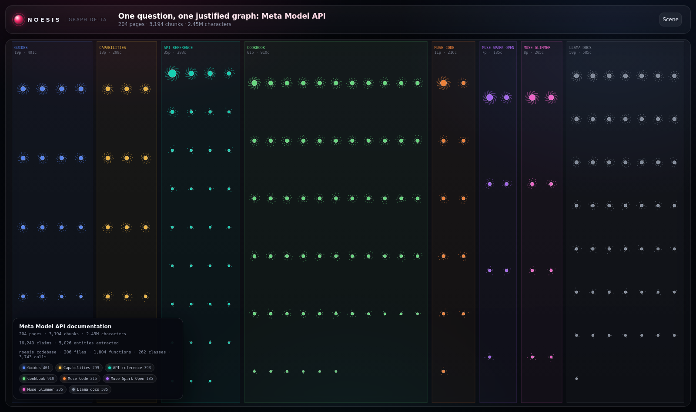

| section filter | a page card | phone corpus |
| --- | --- | --- |
| 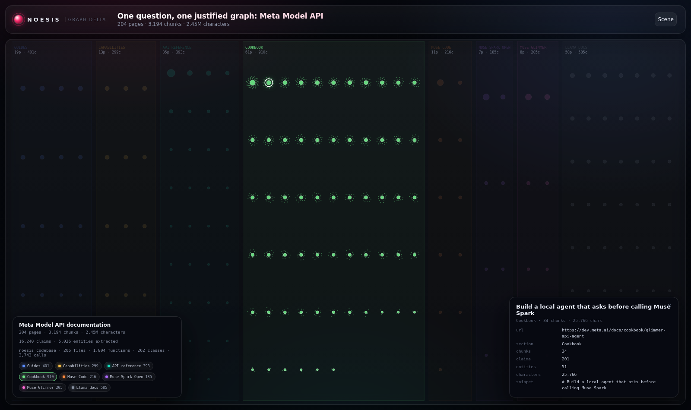 | 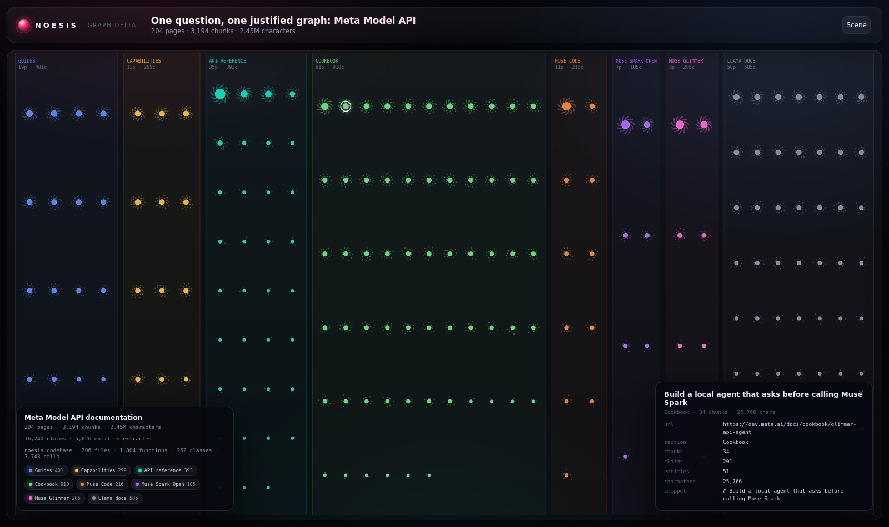 | 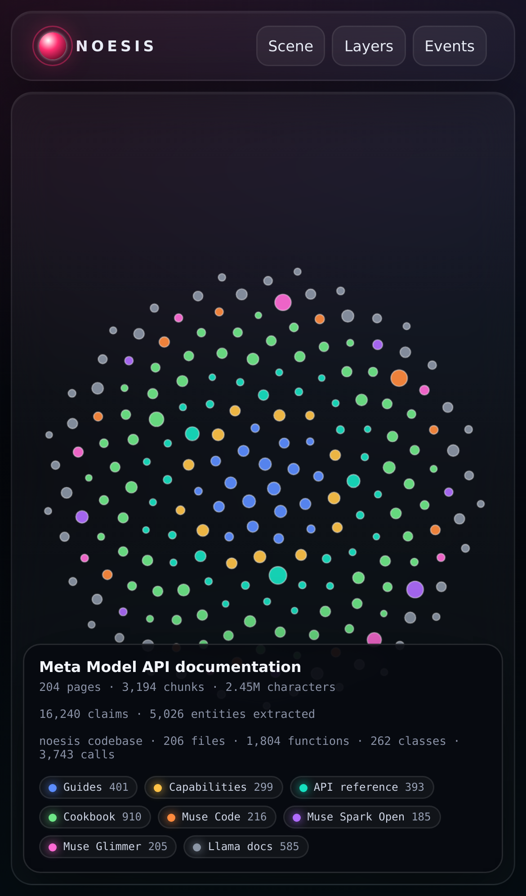 |

## The two layers

| layer | what it is | count |
| --- | --- | --- |
| **Canonical** | Entities and active edges queries are allowed to assume. One entity, one clean edge, 1-hop. | 15 entities |
| **Truth** | The evidence and resolution machinery: 3 source pages, 12 chunks, 27 claims, 19 arguments, mention webs. It may or may not imply the canonical graph. | 62 nodes |
| **Telemetry** | Session/span/tool-call bookkeeping. | 2 |

The canonical entities are the API surfaces the docs describe:

- **7 components**: Muse Wonder, Muse Wonder Full, Muse Spark 1.3, Muse Spark
  Open, Muse Code, Muse Image, Muse Voice Transcribe.
- **5 interfaces**: Responses API, Chat Completions API, Messages API, Images
  API, ASR Realtime.
- **3 capabilities**: Tool calling, Structured output, Reasoning.

Use **`canonical only`** to see exactly the clean 1-hop graph an application
would query. The truth bands disappear and only active canonical edges remain.

```
evidence → claim → argument → canonical entity
             ↑ repoint here when the resolution was wrong
```

## The correction in this recording

The Models page distinguishes two things the surface text “Muse Wonder” can
mean:

- **Muse Wonder** — the hosted model on Model API (`muse-wonder-1.0`).
- **Muse Wonder Full** — the higher-capability variant, available only in Muse
  Code with a subscription, not on Model API.

The recording makes the wrong resolution first: the mention “Muse Wonder” in
the models chunk is resolved to **Muse Wonder Full**, creating
`(Muse Wonder Full)-[:EXPOSES]->(Responses API)` and an `availability =
"Model API"` property — a canonical claim the docs contradict.

The correction calls the real `repoint_entity_reference`:

- the Full resolution `Argument` is set `out`, the Muse Wonder runner-up `in`;
  a feedback argument attacks the old one;
- the old `EXPOSES` edge becomes `status: superseded` with
  `superseded_by`/`superseded_at`; a new active edge is written
  `supersedes: <old id>`;
- `availability` moves from Muse Wonder Full to Muse Wonder (the
  `_property_origins` ledger is transferred);
- the old claim is `superseded`, the Muse Wonder claim `active`;
- the chunk's mention is rewired, and the stale `MENTIONS` edge to Full is
  removed.

The truth layer keeps all of it; the canonical layer shows only the corrected
edge. Open the old edge's card in the **Correction** bundle to see
`status: superseded` and its replacement id.

| the wrong resolution | the correction |
| --- | --- |
| 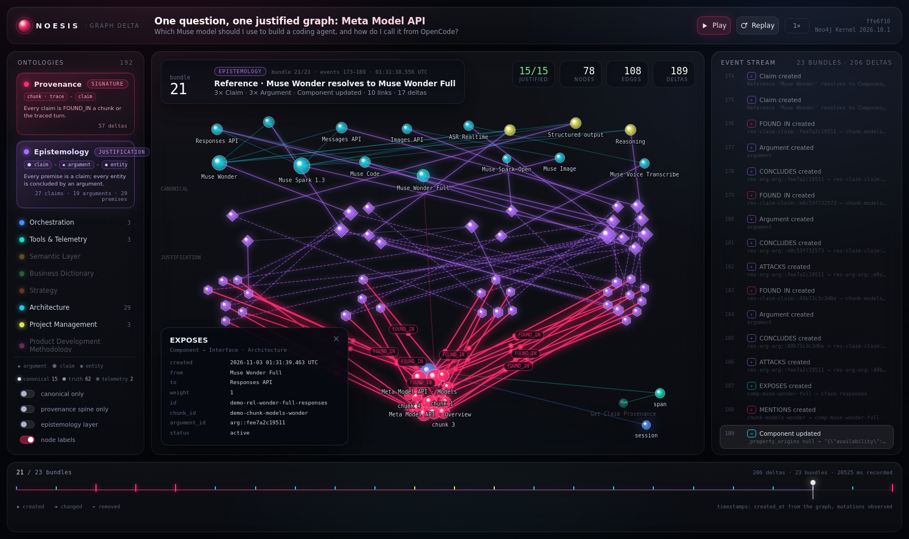 | 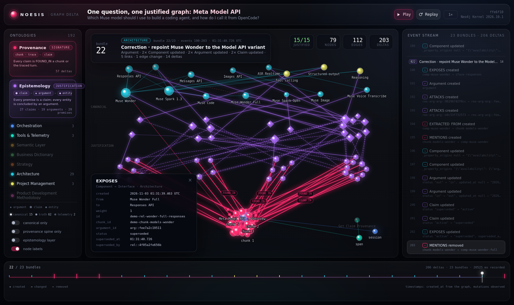 |
| `Muse Wonder` resolves to Full; the edge is active. | The edge is superseded; the replacement is active; the mention moved. |

| canonical only | epistemology layer |
| --- | --- |
| 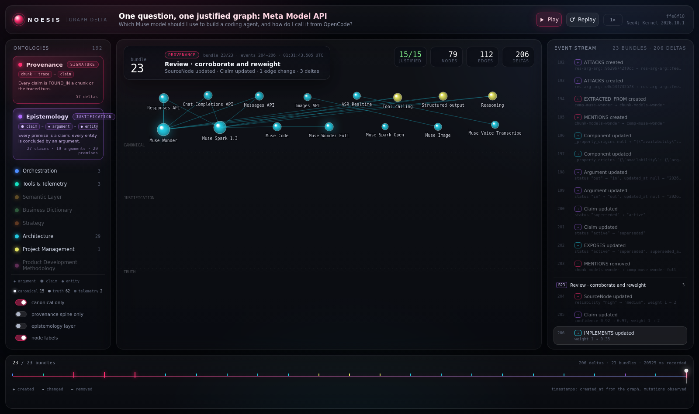 | 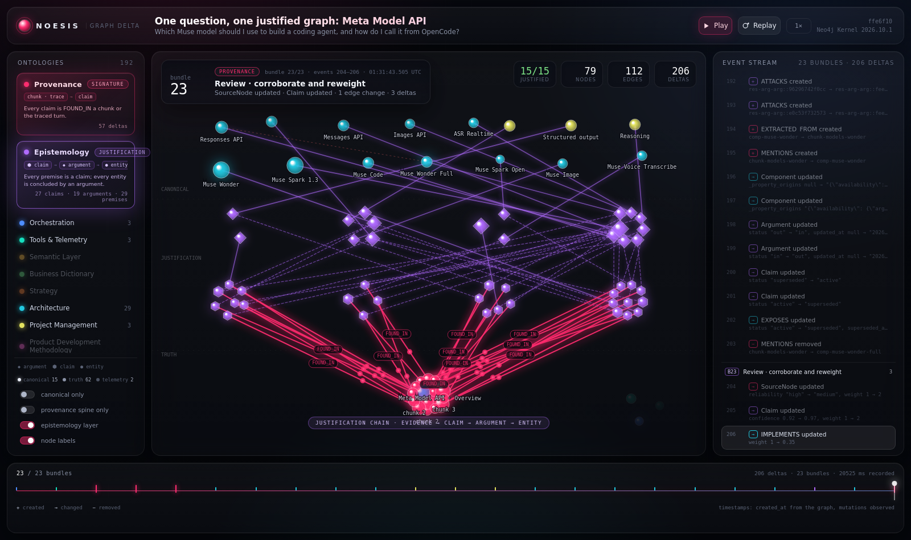 |
| The clean 1-hop graph a query sees. | Arguments and claims only — how the canonical graph is argued into place. |

## On a phone

The same URL works on a phone; the player switches to a single column:

- The **truth layer plays by default** so the build is visible from the first
  turn. Tap **`CANONICAL`** in the timeline for the clean 1-hop graph; tap
  **`TRUTH`** to come back.
- **Layers** and **Events** open as full-screen drawers from the header.
- **Ask the graph** is the floating button above the timeline; the chat drawer
  takes the whole screen and keeps the same read/write tool loop.
- Pinch to zoom, drag to pan, tap a node for a bottom-sheet detail card.
- The HUD and counters collapse to two compact rows; band captions are dropped
  in the phone truth view, and `Muse ` / ` API` are trimmed from labels.

| phone, canonical | phone, layers | phone, detail |
| --- | --- | --- |
| 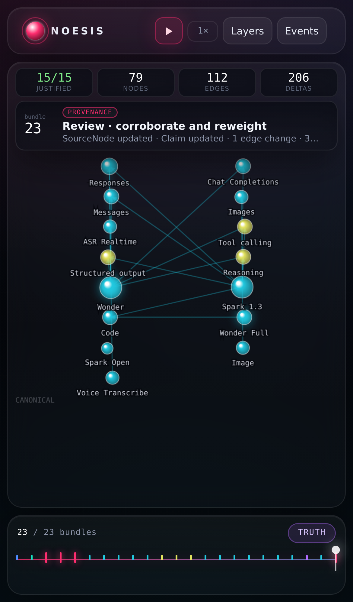 | 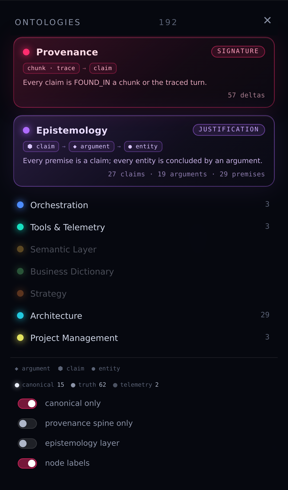 | 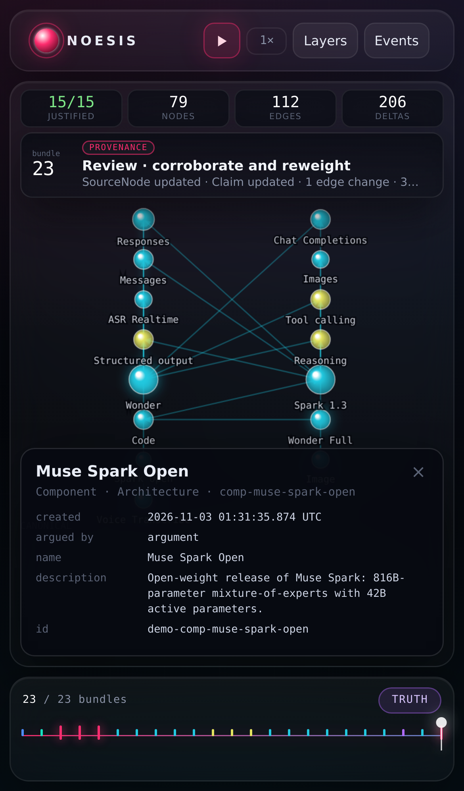 |

## Reading the timeline

- **Colour = ontology.** Labels are coloured by the ontology that owns them;
  edges by the ontology that declares the relationship. `FOUND_IN` belongs to
  `provenance`, pinned first in the legend; the argument layer belongs to
  `epistemology`, pinned second.
- **Bands = layers.** `CANONICAL` on top, `JUSTIFICATION` (arguments and
  claims) in the middle, `TRUTH` (evidence) at the bottom, telemetry at the
  right. The chain reads bottom-up.
- **Shape = role in the argument.** `◆` argument, `⬢` claim, `●` entity.
  Claims and arguments are deliberately unlabelled.
- **A beat is a bundle, not a millisecond.** An entity arrives with its claims,
  grounds, argument and stance edges. The stream groups the 206 deltas under
  `B01` … `B23`; the timeline has one tick per bundle and playback advances a
  whole bundle at a time.
- **Superseded edges are red dashed**; the replacement edge carries
  `supersedes` and glows. `canonical only` hides both the truth layer and the
  superseded history.

## Controls

| input | action |
| --- | --- |
| `space` | play / pause |
| `←` / `→` | step one bundle |
| `R` | restart |
| `L` | toggle node labels |
| `C` | epistemology layer |
| `S` | provenance spine only |
| `canonical only` | the clean 1-hop canonical graph |
| `Corpus` / `Scene` | toggle the full 204-page corpus map |
| click legend row / card | isolate that ontology / layer |
| click a node / claim / argument | property card, including conclusions and grounds |
| click an event row | seek to the end of its bundle and show its target |
| drag / wheel | pan / zoom |

## Rebuilding the recording

```bash
cd noesis
set -a && source .env && set +a
python3 demo/graph_delta/record.py    # runs the scenario, diffs the graph
python3 demo/graph_delta/render.py     # embeds events.json into index.html
```

`record.py` is idempotent: it removes the previous demo entities and the
resolution arguments/claims those chunks produced before replaying. Its chunk
text is derived from the snapshots in `sources/` (navigation labels removed,
whitespace normalized); `source_refresh.py` re-fetches those snapshots from the
three URLs above when the docs change.

To refresh/ingest the full corpus:

```bash
python3 demo/graph_delta/crawl_meta_docs.py            # all 204 pages -> graph
python3 demo/graph_delta/crawl_meta_docs.py --dry-run  # count without writing
```

The corpus lives under the `metadocs-` id namespace, so the demo recorder
never tracks it and the animation stays small.

## Files

| file | role |
| --- | --- |
| `record.py` | scenario + snapshot/diff recorder → `events.json` |
| `events.json` | the recorded delta: nodes, edges, layers and ordered events |
| `template.html` | the player (canvas + vanilla JS, no dependencies) |
| `render.py` | `events.json` + template → self-contained `index.html` |
| `index.html` | the demo you open |
| `sources/` | fetched Meta Model API docs snapshots (URL + text) |
| `crawl_meta_docs.py` | discovers and ingests the full 204-page corpus |
| `extract_meta_claims.py` | Muse Spark claim/argument/entity extraction over every chunk |
| `validate_extraction.py` | checks grounding/premise/conclusion invariants |
| `index_codebase.py` | indexes a real checkout with the development ontology |
| `embed_entities.py` | entity vectors for hybrid entity search |
| `search_entities.py` | family-grouped hybrid entity search CLI |
| `chat_tools.py` | native tool layer: corpus/entity reads, bounded graph writes |
| `server.py` | static page + `POST /api/chat` (Muse Spark tool loop) |
| `sources/metadocs-manifest.json` | full-corpus inventory: URLs, titles, chunk counts |
| `sources/extraction-summary.json` | extraction run totals and model |
| `sources/extraction-report.json` | validated invariant report |
